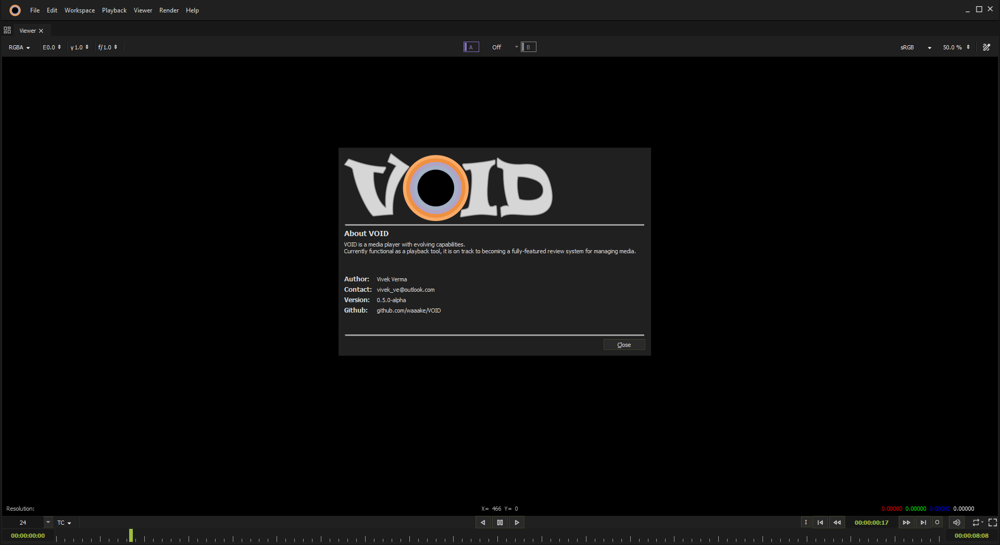

# 
VOID is a player, a growing review system.

This project is a media playback and review system. VOID is designed for working with media through review and editorial processes.
With initial focus being making a reliable playback and media engine.
The full-fledged review platform will enable users to view, analyze, annotate and provide feedback on media.

With development focussed on expanding functionality to include features such as media export and transcoding, Sequence timeline viewer and other editorial tools designed to support a full media ingress-review-egress workflow.

VOID is cross-platform and currently supports **Linux**, **Windows**, and **macOS**. Ongoing development will continue to target all major platforms.

---

## View [changelog](CHANGELOG.md) for updates and [full overview](docs/Overview.md) for more details!

Few highlights of the latest release:

**0.5.0-alpha**
- Added initial version of Sequencer (multi track NLE) with support for Timeline Effects.

## What's coming next?

Features planned for upcoming development:

- Quick Grading and Transformation tools. (Currently Work in Progress)
- Onion peel for annotations.
- Stereoscopic playback support with anaglyph mode.
- Export Processors.
- Improvement of the first version of Movie timeline in a Timeline sequence UI (Sequencer).
